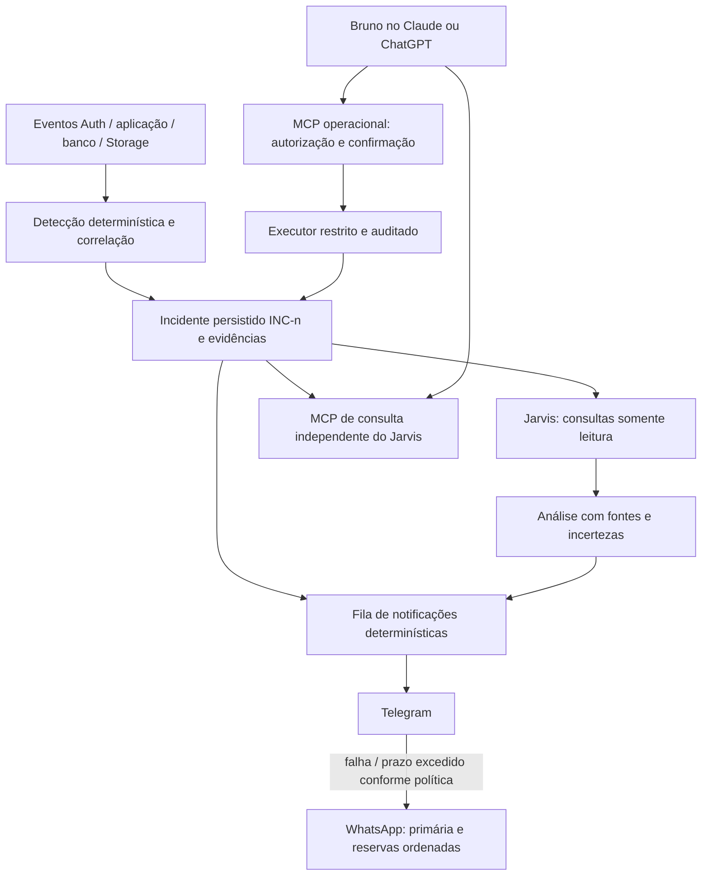

# Segurança BRS — plano mestre consolidado

Data de referência: 31/10/2026, America/Sao_Paulo.
Estado: PLANEJAMENTO DOCUMENTADO. Autorizado nesta rodada: documentação e definição das missões. Não iniciar implementação, deploy, mudanças remotas ou mensagens de teste.
Responsáveis: Bruno decide regras de negócio e autorizações; Claude prepara/executa cada missão liberada; Codex coordena e revisa independentemente.
Este documento substitui o rascunho INCIDENTE-2026-10-31-PLANO-SEGURANCA.md. Evidências históricas e relatórios anteriores permanecem preservados.

## 1. Decisões fechadas pelo usuário

### 1.1 Criação de identidades

- Nenhuma entrada pública cria identidade de acesso, nos três sistemas.
- Workspace: criação por usuário interno existente, ativo e com permissão específica para criar usuários.
- Portal: o formulário Quero ser parceiro cria uma solicitação comercial. Aprovação, provisionamento de login e liberação dependem do usuário autorizado no Workspace > Agente Corban. A permissão de visualizar a tela não equivale à de aprovar/liberar.
- CRM: master principal vinculado ao parceiro aprovado; operacional/atendente criados pelo master autorizado, no próprio parceiro. /atendente é entrada de login, não cadastro.
- Signup público do Auth deve ficar desativado; auditar também OTP/magic link, provedores externos, anonymous sign-in e rotas administrativas para evitar criação indireta. Não criar exceção pública com base no domínio do e-mail.
- A criação administrativa legítima permanece no servidor e exige autorização em cada operação. Chaves administrativas não são fornecidas ao navegador nem ao Jarvis.

### 1.2 Login interno do Workspace

Ordem aprovada:
1. E-mail de domínio exatamente brspromotora.com.br e senha.
2. Confirmação interna de usuário previamente cadastrado, ativo e autorizado para o Workspace.
3. Google Authenticator (TOTP).
4. Código enviado ao e-mail cadastrado.
5. Liberação do acesso.

O domínio não dá permissão por si só. A regra corporativa não pode bloquear globalmente identidades legítimas do Portal/CRM no Auth compartilhado. Mensagens públicas não revelam a existência da conta.

### 1.3 Observação, comunicação e ações

- Jarvis usa a API do Claude e é exclusivamente informador/investigador, sem ação operacional sobre contas, permissões, sessões ou produção.
- Telegram é o canal principal de alertas e conversa com Jarvis.
- MCP operacional separado, autenticado e autorizado, será conectado aos clientes Claude/ChatGPT para intervenções iniciadas por Bruno.
- Jarvis não tem credenciais, conectividade autorizada ou ferramentas desse MCP de ações.
- Sem API Claude disponível, o incidente continua registrado e notificado por mensagem determinística, orientando consulta por ID no MCP ou painel.
- Falha do Telegram usa WhatsApp não oficial como contingência, por instâncias explicitamente escolhidas entre as três informadas por Bruno. Não é envio em massa.
- Alertas agrupados, com prioridade e limites globais, independentemente do canal e da IA.

## 2. Propostas que ainda não são regras aprovadas

| Item | Proposta técnica | Decisão pendente |
|---|---|---|
| CAPTCHA | Turnstile ou hCaptcha, validado no Auth e nos fluxos públicos pertinentes | Provedor e política de interação |
| Tentativas | Pausa inicial após 3 falhas numa janela definida; evolução por risco | Janela, escopo, durações e critérios |
| Bloqueio por 24h | Não automático após apenas 6 erros públicos; evitar bloqueio malicioso de terceiros | Condições e autoridade de liberação |
| Fora de expediente | Usar calendários/horários existentes, fuso e exceções explícitas; alertar por gravidade | Horários aplicáveis e exceções |
| Telegram | Bot de segurança com destino privado autorizado | Bot e chat/user IDs por configuração segura |
| WhatsApp | Primária, reserva 1, reserva 2; uma por vez | IDs/nomes exatos, quantidade habilitada e ordem |
| Destinatário WhatsApp | Número autorizado de Bruno | Confirmar número em configuração privada |
| Último canal | E-mail/outro canal independente quando Telegram e WhatsApp falharem | Canal, destino e disponibilidade |
| Entrega | Alerta inicial alto/crítico sem esperar IA; escalada dentro de prazo definido | SLO e limites de volume |
| Retenção/custos | Retenção de logs e orçamento diário/mensal da IA | Valores, responsáveis e infraestrutura |

Nenhuma pendência autoriza o executor a escolher destinatários, gastar créditos, enviar testes reais ou impor bloqueios globais. Modelos, chaves, números e horários não devem ser inventados.

## 3. Prioridade de segurança

A contenção das exposições conhecidas precede a implantação de Jarvis. O agente não substitui autorização, proteção de documentos ou fechamento do signup.

- Corrigir políticas amplas em disciplinary_records e regras_portabilidade_ifs/globais, com permissões reais por operação.
- Restringir leituras de comunicados, perfis, horários e links ao público legítimo e aos campos necessários.
- Remover promoção automática a admin por domínio e senha fixa de fallback.
- Tornar partner-documents privado com migração dos consumidores e validação de URLs antigas/cache; não prometer revogar cópias já baixadas.
- Revisar sessões/bloqueios, TTL efetivo e permissões com tokens ainda válidos. Revogar refresh não prova expiração imediata de access tokens.
- Revisar RPCs SECURITY DEFINER, views, Realtime, Storage e handlers com service_role.
- Proteger alterações de profile_id, role, permissões, tenant e vínculo Auth; autorização de edição cadastral não permite autoelevação.
- Inventariar credenciais, confirmar cifra pelo código e eliminar cópias recuperáveis de senhas pessoais quando desnecessárias. Planejar desacoplamento da senha do Portal e senha ARW.

As consultas autenticadas revisadas retornaram zero linhas para tabelas de credenciais no estado testado. Isso não prova ausência de extração histórica ou proteção em todos os caminhos. Referência: INCIDENTE-2026-10-31-REVISAO-01A.md.

## 4. Contrato da autenticação em cinco etapas

- Produzir uma máquina de estados explícita, com sessão pendente e acesso completo distintos.
- O código de e-mail é um desafio adicional próprio, não um login alternativo signInWithOtp que dispense a senha.
- Vincular aprovação a user_id + session_id validado + finalidade + validade. Nunca um booleano global por usuário, localStorage ou parâmetro controlado pelo cliente.
- Depois da senha e depois do TOTP, todas as superfícies protegidas ainda negam acesso até concluir o desafio de e-mail. Cobrir APIs diretas ao Supabase, handlers administrativos, Server Actions, views/RPCs, Storage e Realtime pertinentes, não só o proxy da página.
- O servidor decide a identidade e o e-mail de destino; o cliente não pode escolher outra conta, sessão ou caixa para receber o código.
- Código aleatório, curto prazo, uso único, armazenamento protegido, tentativas/reenvios limitados atomicamente. Não registrar valores, QR/segredo TOTP, cookies, bearer tokens ou URLs de autenticação.
- Refresh, logout, expiração, mudança de senha/e-mail, remoção de fator e bloqueio devem ter semântica definida. A autorização de uma sessão não libera outra.
- Ativação inicial do TOTP exige provisionamento legítimo e comprovação adequada do titular; não permitir que um detentor de senha inicial tomada cadastre seu autenticador sem a verificação prevista.
- Planejar recuperação de acesso, último administrador e troca de telefone sem atalhos de autenticação ou credencial fixa.
- Entrega do código por e-mail tem timeout, limite e falha explícita; indisponibilidade não libera acesso. O código de login não é desviado para Telegram/WhatsApp como fallback.
- Preservar a separação entre identidades internas, parceiros e atendentes e seus fluxos SSO. A análise técnica deve localizar o efeito de cookies compartilhados antes de mudar o fluxo.

## 5. Arquitetura de incidentes e independência da IA

- Persistir o incidente e a intenção de notificação antes dos efeitos externos. ID estável, único e consultável por painel/MCP. INC-123 é exemplo de apresentação, não ID reservado.
- Estados de incidente, análise da IA e entrega de notificação são independentes. IA indisponível não fecha o incidente; mensagem aceita pelo provedor não significa lida por Bruno.
- Eventos devem indicar identidade informada versus identidade autenticada pelo servidor; IP/UA/Referer não provam autoria. Registrar cobertura e lacunas de fontes.
- Agrupar por regra/contexto/janela, com limites de cardinalidade; variar IP/e-mail não pode criar chamadas de IA e alertas ilimitados.
- O motor de detecção e as regras de acesso continuam funcionando sem Claude, Telegram ou WhatsApp.
- Falha do banco/Workspace deve ser detectável por monitor independente. Se o registro principal não puder ser criado, usar referência técnica distinta, persistida no mecanismo de contingência; não afirmar que INC-n existe até persistir de fato.

## 6. Jarvis somente leitura

- Ferramentas limitadas: consultar_incidente, listar_eventos_relacionados, consultar_estado_usuario, consultar_configuracao_seguranca e consultas equivalentes revisadas. Retornos mínimos, paginados e sem segredos.
- Identidade técnica própria, sem service_role, SQL/shell genérico, execução arbitrária, ferramentas de escrita ou tokens do MCP operacional.
- Views/funções de consulta não podem ter efeitos de negócio; revisar owners, GRANTs, search_path e limites. Read-only nominal não basta se houver RPC que escreve.
- O serviço de comunicação possui os segredos dos canais; o modelo não recebe esses segredos nem escolhe destino/URL livremente. Destinatários autorizados ficam fora do controle de texto gerado.
- Perguntas pelo Telegram somente de IDs previamente autorizados; webhook autenticado, validação de replay/duplicidade, tamanhos e orçamento. Encaminhamento/username não substitui identificação autorizada.
- Evidências externas e logs são dados não confiáveis. Separar fatos, hipóteses e limites; citações por event/request ID. Nenhuma instrução encontrada em log altera ferramentas, permissões ou destino.
- Saída do Jarvis é informativa, não uma ordem para o MCP. O executor deve buscar as evidências e avaliar a ação independentemente.
- API key em segredo de servidor; redigir dados antes de enviar à Anthropic. Definir modelo, orçamento, retenção e quantidade máxima de consultas/chamadas por incidente.

## 7. Contingência da API Claude

### 7.1 Comportamento obrigatório

O alerta inicial de incidente alto/crítico não aguarda conclusão da IA. A análise complementa o incidente quando disponível.

Se Claude falhar ou o orçamento local impedir a chamada:
1. Manter incidente/evidências e controles de segurança ativos.
2. Marcar análise como indisponível ou adiada, com motivo sanitizado e horário.
3. Comunicar a ocorrência por template fixo pelo canal disponível.
4. Orientar consulta ao INC-n no MCP ou painel, sem depender de outra chamada ao Jarvis.
5. Retomar a análise com fila limitada quando o serviço voltar, sem despejar alertas atrasados e sem repetir ações.

Template proposto:

> BRS Segurança — INC-123 — [gravidade]
>
> [Resumo factual gerado pelo motor de regras.]
>
> Não foi possível acionar o Jarvis: [motivo confirmado ou indisponibilidade não classificada].
>
> O incidente está registrado. Consulte INC-123 pelo MCP de segurança no Claude ou ChatGPT, ou pelo painel autenticado.
>
> [Controles efetivamente aplicados, se houver; nunca inventar bloqueio ou vazamento.]

O limite financeiro da API utilizada pelo Jarvis não equivale necessariamente ao limite do cliente Claude/ChatGPT. Esses clientes também podem estar indisponíveis; o painel é alternativa independente da IA.

### 7.2 Classificação e retries

| Falha observada | Tratamento |
|---|---|
| Orçamento local atingido / saldo insuficiente confirmado | Abrir circuito; não insistir por incidente; sinalizar limite financeiro |
| 429 / limitação de taxa | Respeitar indicação de espera, quando disponível, e backoff com jitter; não chamar toda ocorrência de falta de saldo |
| Timeout, 5xx, sobrecarga | Tentativas limitadas; circuito de falha e mensagem de indisponibilidade |
| Chave inválida / permissão negada | Suspender tentativas repetitivas e alertar configuração; não expor chave/erro bruto |
| Entrada excessiva / erro de contrato | Corrigir/reduzir payload dentro do contrato ou encaminhar diagnóstico técnico; não retry infinito |
| Resposta parcial/inválida | Não publicar conclusão incompleta como diagnóstico validado |

Persistir request_id quando disponível, categoria e resultado. Não substituir automaticamente por outro provedor/modelo pago sem regra aprovada. Credenciais nunca aparecem no template.

## 8. Contingência Telegram → WhatsApp

### 8.1 Seleção e volume

- Telegram é primário. WhatsApp envia alertas operacionais resumidos de contingência, não conversa livre com Jarvis nesta versão.
- Configurar lista ordenada de 1 a 3 instâncias explicitamente autorizadas, pertencentes à BRS. Não escolher default global ou instância de parceiro.
- Tentar uma instância por vez. Reserva é redundância, não balanceamento para aumentar volume ou contornar bloqueios do provedor.
- Mesma cota global por destinatário/incident key para todas as instâncias. Acrescentar teto por instância e limites compartilhados com o tráfego comercial quando aplicável.
- Priorizar alto/crítico, agrupar níveis inferiores e impedir avalanche. Todos os eventos permanecem consultáveis; alertas agrupados podem indicar quantidade suprimida.
- O plano técnico deve propor valores concretos de janelas, SLO e cotas para revisão. Exemplo inicial para discussão: um alerta por incidente na transição crítica, atualizações resumidas em janelas de minutos e orçamento global de notificações. Nenhum número é liberado para produção por este exemplo.

### 8.2 Estados e transição segura

| Estado do Telegram | Próximo passo |
|---|---|
| API aceitou e retornou message_id | Registrar aceitação; não acionar WhatsApp apenas por não haver prova de leitura |
| 429 | Respeitar retry_after; se exceder o prazo aprovado para alerta crítico, permitir uma contingência controlada |
| Rejeição permanente / bot indisponível / destino inválido | Registrar categoria e acionar WhatsApp configurado sem retry infinito |
| Timeout/resposta perdida após envio | Estado incerto; não afirmar falha certa. Política de prazo pode permitir uma única contingência identificada, reconhecendo possível duplicação |

| Estado da instância WhatsApp | Próximo passo |
|---|---|
| Desconectada ou falha comprovada antes da aceitação | Avançar à próxima instância autorizada |
| Provedor aceitou | Não enviar por outra instância; conciliar persistência/recibos |
| DELIVERY_UNCERTAIN, timeout ou resposta perdida após tentativa | Não circular automaticamente pelas reservas. Preservar operationId e conciliar pelo contrato disponível; registrar incerteza |
| Todas indisponíveis / limite global atingido | Persistir pendência e escalar pelo último canal aprovado; não reiniciar ciclo infinito |

Indisponibilidade de recibo não prova não entrega. Aceitação não prova entrega/leitura. Sem suporte do provedor não é possível prometer exactly-once externo; projetar deduplicação interna e explicitar a rara duplicação possível entre canais em contingência urgente.

Usar deliveryIntentId, incidentId, versão do alerta, destino e canal de forma estável; operationId do engine deve ser preservado. Troca de instância antes de aceitação é uma tentativa distinta vinculada à mesma intenção, com prova da rejeição anterior. Não gerar IDs novos para contornar incerteza ou conflitos.

Após recuperação do Telegram, enviar no máximo um resumo útil; não reemitir todo o backlog já aceito pelo WhatsApp. Falha na gravação após aceitação externa leva à reconciliação, não a novo envio.

### 8.3 Falha simultânea e independência

- Definir último canal independente (e-mail ou serviço externo), destino e credenciais antes de considerar homologada a contingência completa.
- Sem canal alternativo funcional, não há como garantir que Bruno seja notificado. Registrar essa condição como falha crítica de observabilidade e apresentar no painel/MCP; não declarar entrega.
- Falha de uma dependência não pode gerar recursivamente incidentes/alertas sem limite.
- Separar credenciais e, quando viável, execução do monitor/dispatcher do próprio Workspace; se todos dependerem do mesmo processo/banco, o plano deve declarar a falha comum.

## 9. MCP operacional

- Serviço independente do Jarvis e da API Claude. Leituras/ações não chamam o modelo para decidir autorização.
- OAuth para transporte remoto conforme protocolo suportado; tokens com público-alvo, emissor, validade e escopos verificados. Conexões Claude/ChatGPT identificáveis e revogáveis separadamente. Compatibilidade real de cada cliente deve ser testada; não inferir da assinatura/plano.
- Expor consultas e ações delimitadas. Proibidos SQL/shell genérico, extração de segredos e alterações de permissões arbitrárias.
- Preparar ação → apresentar alvo/impacto/duração → confirmação verificável → executar → conferir efeito. Aprovação vinculada ao usuário, ação e parâmetros exatos, validade curta e uso único.
- Revalidar autorização e estado antes do efeito; alterações no alvo/escopo invalidam a aprovação. Evitar execução duplicada por chamadas concorrentes/repetidas.
- Ações de maior impacto exigem autenticação completa/recentemente confirmada no Workspace. Sessão no Telegram e texto do Jarvis nunca autorizam ação.
- Registrar antes/depois não sensível, aprovador, cliente, request/action IDs, resultado e verificação. Proteger o último administrador e procedimentos de recuperação.
- Recursos de controle do próprio MCP, auditoria e privilégios do Jarvis não são editáveis pelo modelo.

## 10. Logs, antiabuso e controles permanentes

- Menu Usuários > Logs de acessos, com permissão própria: data/fuso, sistema, etapa, resultado, motivo técnico controlado, identidade informada/validada, request ID, bloqueio/vencimento e desbloqueador.
- Sem senhas, códigos, segredos, corpo integral sensível ou URLs assinadas. Escapar conteúdo não confiável também na UI/Telegram.
- Somente responsáveis autorizados consultam logs; não editar/remover pela interface comum. Retenção, exportação e proteção da cópia devem ser definidas.
- Capturar também chamadas diretas ao Auth/serviços quando a fonte oferecer isso; instrumentação somente da tela não cobre o incidente investigado. Registrar lacunas de fontes.
- CAPTCHA e rate limiting em todos os fluxos pertinentes: Workspace, Portal, atendente, recuperação, reenvio e cadastro comercial/uploads. Configuração compartilhada exige rollout coordenado.
- Contadores persistentes, atômicos e distribuídos. Não localStorage, memória de uma instância ou headers de IP não confiáveis. Erros de infraestrutura não contam como senha incorreta.
- Evitar bloqueio malicioso de conta por terceiro. Horários, exceções e 24h dependem das decisões pendentes; desbloqueio não dispensa MFA.
- CI testa negação e fluxos legítimos. Monitor de configuração detecta RLS/grants/buckets/signup divergentes. Monitorar também saúde da fila, dos coletores e da exportação de evidências.

## 11. Missões do Claude e ordem de revisão

| Missão | Resultado | Dependência / aceite |
|---|---|---|
| M02 — projeto técnico | Plano executável com contratos, consumidores, testes, lacunas e pacotes P0 | Somente leitura/documentação; Codex revisa antes de código |
| M03 — contenção | Correções mínimas de signup/provisionamento, permissões e documentos em pacotes pequenos | Projeto técnico revisado; código/migrations primeiro locais; aplicação remota separada |
| M04 — login | Fluxo completo de cinco etapas, ativação/recuperação e enforcement | Sem liberação parcial que deixe AAL1/AAL2 acessar antes do e-mail |
| M05 — eventos e painel | Incidentes, correlação, logs de acessos, monitor e evidências | Testes de identidade/tenant, integridade e indisponibilidade |
| M06 — notificações | Telegram e WhatsApp de contingência, sem dependência de IA | Configurações definidas; testes de falha e duplicidade |
| M07 — MCP | Consulta e ações restritas com aprovação verificável | Contratos de ação e autorização revisados; homologar nos dois clientes |
| M08 — Jarvis | Diagnóstico somente leitura, diálogo e contingência de API | M05/M06; conta e orçamento definidos; testes de injection/exfiltração |
| M09 — homologação | Cenários integrados, recuperação e observabilidade | Evidências por pacote; teste remoto somente autorizado |

Cada missão define arquivos próprios, critérios, comandos/testes, relatório e parada para revisão independente. Não liberar uma execução monolítica de M03 a M09. Contenção pode avançar em pacote revisado sem esperar os módulos de IA.

## 12. Matriz de aceitação obrigatória

1. Signup público recusado; cadastro comercial não cria Auth; provisionamento administrativo legítimo funciona e respeita tenant/permissão.
2. Domínio errado, conta sem vínculo ou inativa: acesso interno negado. Alterar e-mail/IDs no cliente não muda a identidade validada.
3. Senha concluída sem TOTP; TOTP concluído sem e-mail; código vencido/reutilizado/de outra sessão: dados protegidos negados, inclusive API direta.
4. Parceiro A não acessa B; operacional/atendente não elevam perfil; edição cadastral não concede privilégios.
5. Bloqueio/expiração/MFA removido revogam a autorização prevista; recuperação não abre atalho nem bloqueia permanentemente o último administrador.
6. API Claude sem saldo, chave inválida, 429, timeout e 529: incidente e alerta determinístico disponíveis; orçamento/retry respeitados; MCP/painel continuam consultáveis.
7. Telegram retorna 429, 403 ou timeout: comportamento conforme política; mensagem aceita e falha de persistência não duplica automaticamente.
8. WhatsApp primária indisponível: reserva autorizada; primária aceita: reservas não enviam; envio incerto: não rodar a lista às cegas; nenhuma instância externa selecionada.
9. Milhares de eventos e IDs variados: agrupamento e limites globais funcionam; não multiplicar custo da IA ou mensagens pelas três instâncias.
10. Todos os canais falham: falha registrada e monitor independente acionado se configurado; nenhuma entrega fictícia.
11. Conteúdo malicioso no log: Jarvis não escreve, não extrai segredos nem muda destinatário. Relatório do Jarvis não autoriza o MCP.
12. MCP com token inválido/escopo insuficiente, confirmação vencida/repetida/alvo alterado: ação negada; cliente legítimo com aprovação válida executa uma vez e registra resultado.
13. Banco/dispatcher indisponível, reinício, concorrência e recuperação: intenções preservadas, leases/locks testados e efeitos reconciliados.
14. Canais restaurados: resumo, sem avalanche de backlog; alerta de saúde não provoca recursão infinita.

Usar fixtures e provedores simulados primeiro. Nenhuma mensagem real, cobrança de API, criação/banimento de usuário real ou teste destrutivo decorre desta documentação.

## 13. Critério para dizer que está pronto

Registrar por pacote: documentado, implementado localmente, revisado, aplicado e verificado. Build/teste unitário não prova RLS remoto, entrega, ausência de bypass ou segurança histórica.
Exigir evidências de teste negativo, fluxo legítimo, falhas de dependências, recuperação, observabilidade e limites de custo/volume. Não declarar incidente resolvido com a entrega do Jarvis.

## 14. Fontes e referências

- Relatórios e revisões: INCIDENTE-2026-10-31-RELATORIO-01.md, RELATORIO-01A.md e REVISAO-01A.md nesta pasta (prefixos completos).
- Contrato local de envio: brs-workspace/src/lib/central-conversas/engine.ts. Há tratamento explícito de envio incerto; presença de operationId não comprova que o modo durável esteja ativo em produção.
- Adapter Z-API legado: brs-workspace/src/lib/zapi/send.ts. Leitura encontrou continuação do envio após falha do log e tratamento genérico de falhas; não reutilizar como dispatcher confiável sem revisão.
- https://platform.claude.com/docs/en/api/errors
- https://platform.claude.com/docs/en/api/rate-limits
- https://core.telegram.org/bots/faq
- https://core.telegram.org/bots/api#responseparameters
- https://modelcontextprotocol.io/specification/latest/basic/authorization
- https://modelcontextprotocol.io/specification/latest/basic/security_best_practices
- https://supabase.com/docs/guides/auth/auth-mfa
- https://supabase.com/docs/guides/auth/auth-captcha
- https://supabase.com/docs/guides/auth/rate-limits

